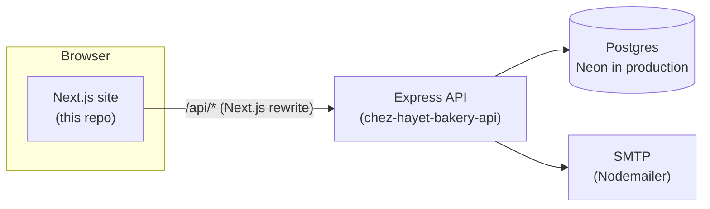

# 🧁 Chez Hayet Bakery

A full-stack website for Chez Hayet, a home bakery making cakes, traditional Algerian sweets, cookies and custom creations. Customers browse the menu and send orders or messages; the baker logs in to a private dashboard to manage orders and reply to messages by email.

**Live site:** [chezhayetoh.com](https://www.chezhayetoh.com) · **API repo:** [chez-hayet-bakery-api](https://github.com/LynzTighers/chez-hayet-bakery-api)

       

## Features

**For customers**
- Pages for the home, menu, about, where to buy, follow us and contact
- An order form (category, product, details and pickup date) and a contact form
- The API checks each form with zod, and any problems show up next to the field they belong to

**For the baker** (`/admin`)
- Username and password login
- Orders dashboard: see every order and move it through `new → confirmed → completed` (or `cancelled`)
- Messages dashboard: read contact messages and reply; the reply is emailed to the customer

## How it works



- The browser only ever talks to this site. `next.config.ts` forwards `/api/*` to the Express API, so the login cookie stays on one domain and no CORS setup is needed.
- The API validates every request with zod and stores orders, messages and replies in Postgres (Drizzle ORM).
- **Baker login:** passwords are hashed with bcrypt. A successful login sets an `httpOnly`, `sameSite=lax` session cookie whose hash is stored in the database, and repeated wrong passwords lock the username for 15 minutes.
- Contact replies are sent with Nodemailer. In Docker they go to Mailpit, a local test inbox, so no real emails are sent.

## Project structure

```
app/
  page.tsx, menu/, about/, where-to-buy/, follow-us/, contact/, order/   public pages
  admin/            login page and the orders/messages dashboard
  components/       navbar, forms, decorative pieces
  lib/              API helpers and shared types
next.config.ts      /api proxy to the Express API
```

## Running locally

You need Node.js and the [API](https://github.com/LynzTighers/chez-hayet-bakery-api) running on port 4000 (its `docker compose up --build` starts the API, Postgres and Mailpit together).

```bash
npm install
npm run dev
```

Then open http://localhost:3000. The site sends API calls to `http://localhost:4000` by default. Set `API_URL` to point it somewhere else, as the Vercel deployment does.
